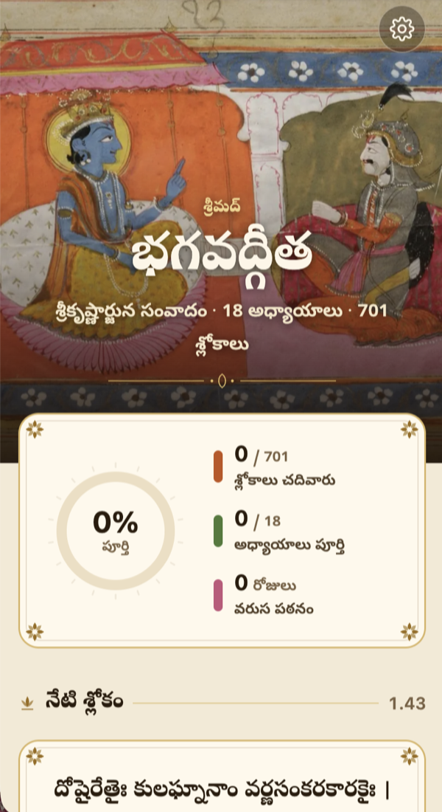
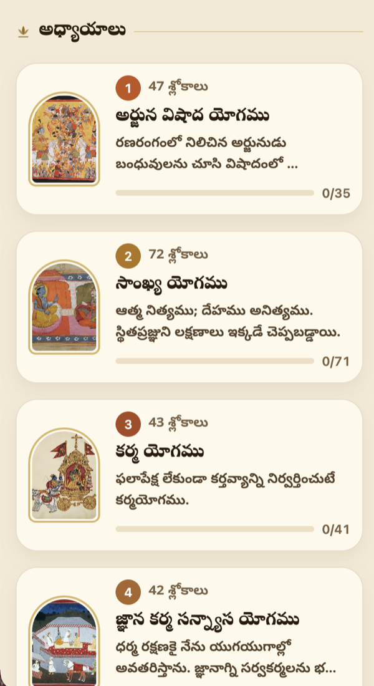
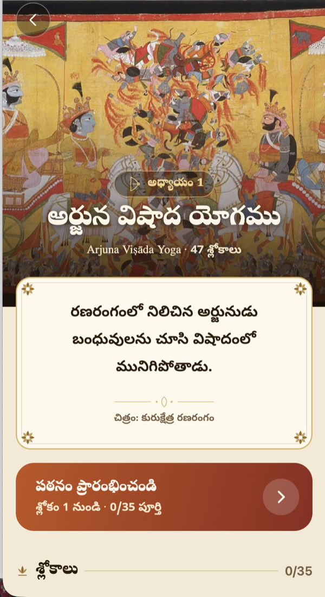
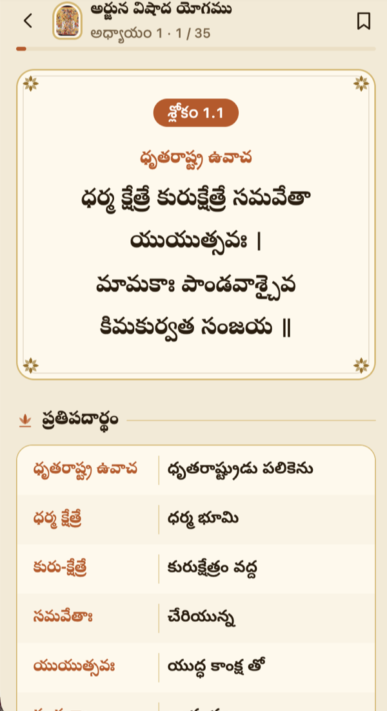

<h1 align="center">భగవద్గీత</h1>
<p align="center"><em>A quiet, offline Bhagavad Gita reader in Telugu, built with Expo.</em></p>

<p align="center">
  
  
  
  
  
  <a href="https://github.com/KousthubhaKrishna/gita/releases/latest"></a>
</p>

---

All 700 slokas, word-by-word meanings, two Telugu translations and a full commentary,
bundled into the app so it works with no network at all. Designed to be read a page at a
time, the way a printed Gita is.

<table align="center">
  <tr>
    <td align="center"></td>
    <td align="center"></td>
    <td align="center"></td>
    <td align="center"></td>
  </tr>
  <tr>
    <td align="center"><sub>Home: progress ring, streak, నేటి శ్లోకం</sub></td>
    <td align="center"><sub>18 chapters, each with its painting</sub></td>
    <td align="center"><sub>Chapter page, pick up where you left</sub></td>
    <td align="center"><sub>Reader: sloka and ప్రతిపదార్థం</sub></td>
  </tr>
</table>

## Features

- **Verse-at-a-time reading.** Each sloka is one page. Swipe horizontally through a chapter; the app
  remembers where you stopped.
- **Layers you can switch on.** Telugu sloka is always shown. Devanagari, IAST transliteration, a second
  Telugu translation, and an English translation are each a toggle in Settings.
- **ప్రతిపదార్థం and వ్యాఖ్యానం.** Word meanings sit under every verse. The long commentary is loaded on demand
  so chapters stay light.
- **Progress without pressure.** Read verses, bookmarks, a day streak, and a chapter progress ring. A
  "verse of the day" walks the whole text once every ~650 days.
- **Two visual styles.** Classical Indian miniature paintings, or photographs of Gita sites and Ravi Varma prints.
  Nature scenes, lotuses, mandalas and chapter emblems are drawn in code with SVG.
- **Typography first.** Noto Serif Telugu and Noto Sans Telugu, five text sizes, three weights, light and
  dark themes, large tap targets.

## Install on Android

The easiest path is the prebuilt APK, no store account needed:

1. On your phone, open the **[latest release](https://github.com/KousthubhaKrishna/gita/releases/latest)** and download `gita-vX.Y.Z.apk`.
2. Tap the downloaded file. Android will ask once to allow installs from your browser or Files app.
3. Open భగవద్గీత. Everything is on the device; it never needs a network.

Each release carries a `SHA256SUMS.txt` you can verify against. Updates are manual: install the newer APK over the
old one and your reading progress is kept. iPhone users can run the app through Expo Go for now (see Getting started).

## Getting started

```bash
git clone git@github.com:KousthubhaKrishna/gita.git
cd gita
npm install

# Fetch and compile the verse data (not shipped in this repo, see below). ~2 minutes.
npm run data

npx expo start
```

The app runs in Expo Go on iOS and Android, and in the browser with `npx expo start --web`.
Release builds go through EAS: `npx eas-cli build --profile preview --platform android`.

### Artwork

The painting and photo sets are also not committed. `assets/art/README.md` lists every file the app expects,
with the exact source and licence of each, so you can download them from Wikimedia Commons and The Met.
Everything else in the UI is vector and renders without them.

## Project layout

```
src/
  app/            Expo Router screens: home, chapter, reader, settings, about
  components/     VersePage, ChapterComplete, art/ (SVG scenes, frames, lotus, ornaments), ui/
  data/           chapters, art manifest, verse loader; verses/ and purport/ are generated
  store/          zustand stores persisted to AsyncStorage: settings, reading progress
  theme/          design tokens, chapter hues, light/dark theme provider
  lib/            Telugu numeral and text helpers, shared types
scripts/data/
  fetch_sources.py   downloads the two raw sources into scripts/data/raw/
  compile.py         normalises them into compact per-chapter JSON the app bundles
assets/
  fonts/          Noto Telugu families (OFL)
  art/            paintings and photographs (download separately, see README there)
  source/         make_icon.py, which generates the app icon as SVG
```

## Data & licences

The application code is MIT licensed (see `LICENSE`). The texts and media it displays are third-party works
with their own terms, which is why the compiled data and artwork are generated locally rather than committed:

| Content | Source | Terms |
|---|---|---|
| Telugu sloka, word meanings, translation, commentary | Swami Mukundananda, [holy-bhagavad-gita.org](https://www.holy-bhagavad-gita.org/), via [gita-api.vercel.app](https://gita-api.vercel.app) | Copyright the author. Personal, non-commercial reading only. |
| Second Telugu translation | Swamini Saradapriyananda (Chinmaya Mission), via [te.wikisource.org](https://te.wikisource.org/wiki/భగవద్గీత_-_తెలుగు_అనువాదము) | CC BY-SA 4.0 |
| Devanagari text, IAST, English translation | [nvkudva/Bhagavad-Geeta](https://github.com/nvkudva/Bhagavad-Geeta) compilation (Swami Sivananda's translation) | As stated by that repository |
| Fonts | Noto Serif Telugu, Noto Sans Telugu (Google / Noto) | SIL Open Font License 1.1 (`assets/fonts/OFL.txt`) |
| Paintings and photographs | Wikimedia Commons, The Metropolitan Museum of Art | Public domain, CC0, CC BY, CC BY-SA per image (`assets/art/README.md`) |

The Sanskrit text of the Bhagavad Gita itself is in the public domain. The same credits are shown inside the
app under "మూలాలు & కృతజ్ఞతలు".

If you distribute a build of this app, you are responsible for complying with the terms above, in particular
the non-commercial restriction on the commentary.

## Development

```bash
npm run lint        # expo lint
npm run typecheck   # tsc --noEmit
npm run data        # refetch and recompile verse data
npm run release     # build an APK on EAS and publish it as a GitHub Release (see scripts/release.sh)
```

Releases are tagged `v<version>` from `expo.version` in `app.json`. Bump that, commit, then run `npm run release`.
`.easignore` controls what is uploaded to EAS: unlike `.gitignore`, it keeps the generated verse data and artwork in
the build while still excluding the raw sources.

Contributions that improve the reading experience, accessibility, or Telugu typography are welcome.
Please do not open PRs that commit the generated data or artwork.
